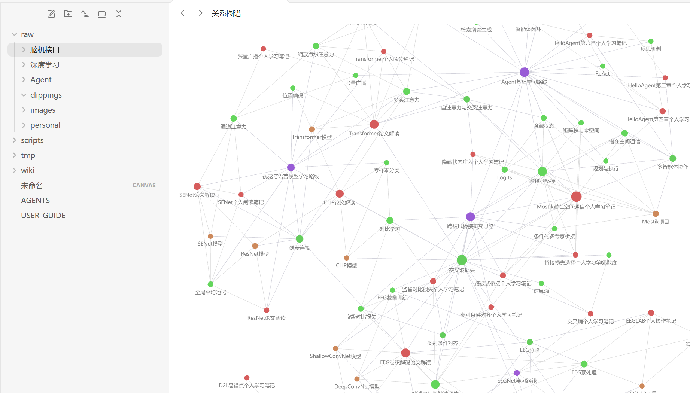

# 周报（2026年10月5日—10月11日）

## 💡本周思考

1. 学习A2A协议时了解到Mostik，开始关注如何通过改进Agent之间的信息传递方式，提高协作效率。
2. 在自己通过Vibe Coding开发的项目中加入类似Obsidian的关系图，尝试用图谱梳理信息之间的关联。
3. 初步了解Personal Agent，但尚未上手尝试，感到仍有一定使用门槛。
4. 学习了一些软件工程基础知识，例如先编写PRD，明确需求、任务边界和验收标准，再开展Vibe Coding，让Agent的执行过程更可控。

## 一、本周完成的工作

### （一）第1章学习

1. 已完成第1章学习，运行实验1.2的真实搜索、工具结果回传与完整Agent循环。
2. 完成实验1.4本地图像生成对照，比较原始与改写提示词下的4张图片；实验1.3按个人安排跳过。

### （二）第2章上下文工程

已读完第2章正文，并完成学习笔记整理。主要实验进展如下：

1. **本地模型与工具调用（2-1）**：部署qwen3:0.6b，完成普通对话、天气工具调用及结果回传，理解Agent循环中的消息组织。
2. **注意力可视化（2-2）**：提取28层、每层16个头的真实注意力，观察不同层与头的分布差异，以及后层对首token的集中关注，保存热力图和原始矩阵。

3. **上下文与KV缓存（2-3）**：完成六种上下文方式对照。稳定前缀缓存比例97.09%，修改系统时间后降至3.90%；滑动窗口虽保留较高缓存，却丢失关键编号，说明缓存效率与信息完整性需分别评价。
4. **提示工程与注入攻防（2-4、2-5）**：完成六组提示词消融和三类注入案例对照。小模型能填写参数，但工具决策不稳定；直接注入仍能泄露测试假密钥，尚不足以判断防御效果。
5. **论文生成PPT（2-6，部分完成）**：使用官方PPTX Skill处理Transformer论文，已保存13页HTML页面稿和4张论文图表；因API限流，最终PPT导出与验收待完成。
6. **上下文压缩（2-10）**：完成六策略、共14次本机请求。带引用任务感知组答对11/12个事实、5/6个来源，但摘要仍有错误，说明压缩长度与信息忠实性需同时检查。

### （三）llm_wiki知识库建设

1. 已完成知识库搭建，在raw中按脑机接口、深度学习、Agent等方向分类并上传资料，整理相关概念与学习笔记的关联。

图1：知识库的raw资料分类及关系图谱。

### （四）jev接入尝试

1. 购入支持API调用的账号并尝试接入；本人调用时遇到中国地区访问限制，未能成功使用，已记录此次测试结果。

### （五）AI辅助Visio绘图

1. 首次使用GPT 6 Astra操作电脑上的Visio进行自动绘图，体验通过自然语言指令完成桌面软件绘图任务。

### （六）英语六级备考

1. 每天坚持背诵100个单词，为英语六级考试做准备。

## 二、本周未完成的工作

| 工作内容 | 完成度 | 已完成部分 | 未完成部分 | 未完成原因 | 下周补救计划 |
| --- | --- | --- | --- | --- | --- |
| 体育锻炼 | 部分完成 | 已进行篮球锻炼 | 未进行跑步 | 篮球的吸引力更大，优先选择了篮球锻炼 | 下周至少安排两天跑步 |
| 选做实验 | 部分完成 | agent-skills-ppt（2-6）已保存13页HTML页面稿、4张论文图表及来源清单，材料和工具链通过 | 生成最终PPTX并验收；2-7暂缓，system-hint尚无本次运行证据 | API限流，最近服务端要求等待37分钟，尚无最终PPT；其余按本人安排暂缓或待确认 | 保留本次中间稿与日志，根据后续额度和本人安排续做 |

## 三、下周工作计划

下周：2026年10月12日—10月18日，初步安排如下：

1. 🔴 **【紧急】初步了解[OpenMAIC项目](https://github.com/THU-MAIC/OpenMAIC)**：阅读项目说明，了解多Agent互动课堂的核心功能、运行流程与部署要求，整理初步调研笔记。
2. 🔴 **继续学习第3章**：阅读正文、整理核心概念，完成一个基础实验并记录结果。
3. 🔴 **跑步锻炼**：至少安排两天跑步，并记录完成情况。
4. 🟡 **收尾论文生成PPT实验**：API调用条件恢复后，复用已有页面稿完成PPT导出，检查图文对应关系与排版。
5. 🟡 **持续维护llm_wiki知识库**：补充本周学习资料和笔记，完善来源标注、概念链接与分类。
6. 🟡 **深入了解Agent通信方式**：梳理A2A与Mostik的作用及区别，整理一份对照笔记。
7. 🟢 **尝试Personal Agent**：了解部署与接口要求，条件允许时完成一次基础任务体验，记录使用门槛和问题。
8. 🟢 **完善项目关系图**：结合实际使用优化浏览和节点定位体验，完成小幅功能改进。

## 四、需要提供的帮助或资源

| 求助事项 | 求助人 | 求助状态 | 对方反馈 |
| --- | --- | --- | --- |
| 受Mostik的Agent交流方式启发，探索其对BCI跨被试问题的借鉴价值，目前尚无具体方案 | 李昱辉 | 探索中 | 提出从跨被试和跨范式两个方向探索的想法 |

