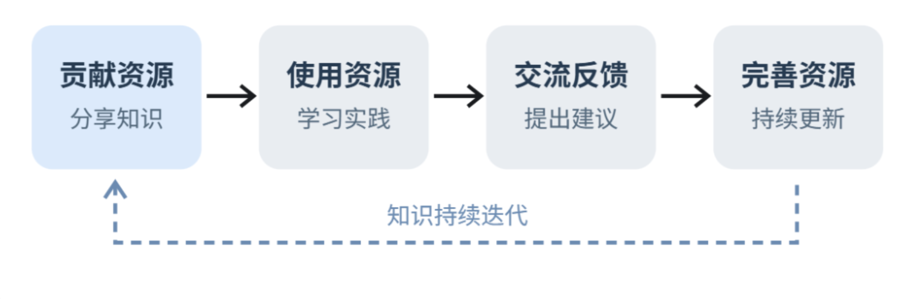

# 周报（2026年10月19日 — 2026年10月25日）

> 报告人：胡博  
> 报告生成日期：2026年10月25日

## 一、本周思考

### 1.Agent学习

学完第四章“工具”和第五章“Coding Agent 与通用 Agent”，结合本周实验，我更关注 Agent 怎样获取信息、组织行动并验证结果，主要有以下体会：

- **工具设计要贴近任务目标**：工具需要说明使用场景、参数和返回结果，并合理整合操作步骤。归档 MCP 将章节选择、命名和保存合并为一次调用，让我理解了接口设计如何减少模型的协调成本。
- **能力接入后，还需要有效发现和选择**：工具增多会带来选择和上下文负担。主动发现实验让我认识到，Agent 需要按任务补充所需能力，效果受工具描述、检索和模型选择共同影响；说明量减少也不一定带来更快执行。
- **代码是扩展 Agent 能力的重要方式**：第五章的“元能力”让我理解，Agent 可以通过代码组合基础工具、生成新的处理方法，并将代码、数据和中间结果保存在文件系统中，供后续任务继续使用。

### 2.学习方式的思考

经过这周对agent工具调用的具体学习，和为自己量身定做的一个学习笔记归档的MCP工具开发的过程，让我认识到，现在我们学习不再是之前那样通过大众通用的学习方式去学习知识，而是可以通过一种定制化的方式打造个人风格的学习方式，从被动接受别人传输的知识转变到在现有个人学习土壤上长出自己对知识的理解

## 二、本周完成的工作

### （一）Agent 工具与 Coding Agent 理论学习

1. 阅读并整理第四章“工具”，形成对工具分类、面向 Agent 的接口设计、参数传递保真、专用工具与通用执行器取舍、MCP 与 Skill 生态、按需工具发现的认识；结合实验理解多模态感知、执行验证、安全边界和重复调用处理等具体机制。
2. 阅读并整理第五章“Coding Agent 与通用 Agent”，重点学习编码任务中的读取、修改、运行和纠正过程，以及 Harness、故障分类与恢复机制；梳理代码作为元能力的六个应用方向，形成《工具与 Coding Agent 学习笔记》

### （二）Agent 实验与问题修复

1. **主动工具发现实验：理解 Agent 如何找到所需能力**

   **实验结果：**在126个模拟工具、8项任务中，对比全量注入、检索预筛选和主动发现三种策略，精确选对任务数分别为4/8、4/8、5/8；主动发现的工具说明 token 较全量减少91.74%。修复 MCP 兼容和代码子进程问题后，真实 MCP 对照两组各完成3/3任务，并取得论文 PDF 和贡献者图表等产物。主动发现耗时33.050秒，全量注入为28.090秒。

   **理解收获：**这个实验把“工具已经接入”和“Agent 能在合适的时候找到并选对工具”之间的差别呈现了出来。一次预筛选可能遗漏后续需要的能力，主动发现则允许执行中补充，。我因此更能理解工具描述、检索与模型选择各自的作用；同时，工具说明减少并不自动带来更快执行，评价方案需要分别看选用是否正确、任务是否完成，以及上下文和时间开销。

2. **多模态 Agent 实验：理解输入表征与按需补充感知**

   **实验结果：**使用 DeepSeek 对同一张 PNG 图表执行原生多模态、先抽取文本再推理、抽取加工具三条路径，均正确回答最高营收为Q4、1.8亿美元；在颜色追问中实际执行图像分析工具调用。

   **理解收获：**三条路径让我看到，材料以什么形式进入上下文，会影响 Agent 能依据哪些信息作判断。本例的文本抽取保留了季度、数值和单位，因此足以回答营收问题；后续颜色追问则演示了通过工具再次查看原图的过程。由此，我开始关注当前问题需要哪些信息，以及已有表征是否足够。该样例帮助我理解了按需感知的机制，但尚不足以判断三种路径在复杂材料上的普遍优劣。

3. **执行工具实验：理解动作、副作用与实际运行边界**

   **实验结果：**记录20次真实 MCP 调用和2次真实 LLM 危险操作审查，验证代码语法校验、文件编辑与工作区边界、终端超时、危险命令拒绝、长输出落盘及 Webhook 调用。最终7项验收通过、8项因环境或凭据受限而阻塞，整体未完成。其中代码执行曾降级为本地进程，网络请求仍能成功，未达到容器和网络隔离要求。

   **理解收获：**这一实验让我具体理解了感知工具与执行工具的差异：执行会改变外部状态，因而必须检查动作是否被允许、实际运行环境是否符合要求，以及结果是否经过验证。尤其是本地进程执行成功却没有实现预期隔离的情况，使我认识到应核对工具返回值背后的实际条件。语法检查、超时处理和长输出保存，也让我看到工具怎样将执行反馈转化为 Agent 下一步可以利用的信息。

4. **Coding Agent 实验：理解由反馈推动的连续任务过程**

   **实验结果：**完成创建 Python 问候程序、实际运行、读取并修改需求、增加中英文问候与非法参数处理、生成并运行测试的两阶段任务。修复 Windows Shell 语法、UTF-8 读取、解释器选择和 CLI 退出状态等问题，最终项目测试172项通过；生成程序的5项测试通过独立重跑，并保留初版、修改版和运行证据。

   **理解收获：**原本抽象的“观察—行动—反馈”过程，在这里变成了可跟踪的读取文件、编辑代码、执行命令和检查结果。第二阶段通过读取已有文件继续修改，也让我理解了文件系统如何承接不同轮次的工作。项目测试与生成程序的功能检查分别验证不同对象，这提醒我验收要对应具体需求。排障过程则帮助我把模型决策、工具实现和环境条件分开分析，理解 Harness 如何支持 Agent 完成持续迭代。

### （三）学习笔记归档 MCP 工具开发

1. **实现笔记归档工具 `archive_learning_note`**：支持通过 MCP stdio 接入，也可通过命令行或核心函数调用。输入标题、章节列表、完整 Markdown 正文和可选文件名，即可按章节归档到 Obsidian 笔记库，减少手动建目录、命名和保存的重复操作。
3. **完成真实接入与归档验证**：通过 MCP 发现并调用工具，将第四、五章学习笔记归档至 Obsidian 的“第04-05章”目录；首次调用返回 `created`，重复调用返回 `unchanged`。归档文件与来源文件逐字节一致，来源文件保持原样。
4. **完成测试与使用说明**：覆盖正文保真、重复调用、冲突保护、目录边界、并发写入、失败清理、CLI 和真实 MCP 子进程调用等场景；本次重跑30项测试全部通过，并提供 README、配置示例与真实调用结果记录。
5. **通过工具开发落实两章的设计原则**：这次实践让我把 MCP 从接入概念落实到一个有明确任务目标的工具接口。章节排序、文件命名、内容比对和写入检查由程序处理，模型负责提供待归档内容并根据回执决定后续动作；重复调用返回 `unchanged`、同名不同内容返回 `conflict`，也使我具体理解了幂等性与冲突处理的作用。工具解决了学习笔记可靠保存这一环节，后续的检索、知识整理和复用仍需继续设计。

### （四）团队知识库建设：

#### 1.将知识库分成四类资源：

- 基础知识区：教材笔记、课程资料、基础概念、学习路线。
- 实践经验区：项目案例、代码示例、踩坑记录、解决方案。
- 优质资源区：工具推荐、优秀文章、视频教程、开源项目。
- 问题讨论区：成员提出的问题、讨论过程和最终解决方法。

#### 2.形成“贡献—使用—反馈—改进“机制

#### 3.如何团队保持活力

计划每周可以设置一个小主题比如：

- 第一周：分享一个最近发现的高效学习工具。
- 第二周：分享一个自己解决过的技术问题。
- 第三周：共同学习一个新知识点。
- 第四周：展示自己利用知识库完成的学习成果。

这样可以让团队持续产生新的讨论，而不是上传完资料就没有后续。

#### 4.我的收获

这部分不仅可以从知识获取的角度考虑，还可以从个人能力和团队关系来分析。

- 提高学习效率

不需要所有知识都从零开始搜索，可以借助其他成员的笔记、经验和推荐资源，更快找到学习方向。

- 拓宽知识视野

每个人关注的领域不同，通过交流能够接触到自己原本不会主动学习的内容，减少个人知识盲区。

- 提升表达与思考能力

将学到的知识整理并分享给别人，需要真正理解其原理。别人提出的问题，也会促使我进一步思考。

- 增强解决问题的能力

遇到困难时可以利用团队成员不同的思路共同分析，也能通过其他人的实践案例积累经验。

- 培养协作与组织能力

参与知识库建设，需要学习如何分工、沟通、协调和管理资源。这些能力在今后的项目合作中也很重要。

### （五）课程学习：

1.完成数据结构压缩矩阵的转置实验报告

2.完成数字逻辑的第二次阶段性测试

3.完成高数多元积分的应用

## 四、下周工作计划

1. **推进归档 MCP 工具的日常使用**：将现有工具用于新增学习笔记，记录实际调用中的问题，整理从笔记形成到归档确认的简短操作流程，形成可供他人复用的示例。（计划10月28日前）
2. **持续整理学习与实验记录**：及时沉淀新增笔记、失败原因和可复用操作，保留关键调用与产物证据，为后续复盘和周报汇总提供依据。（10月26日—10月30日）
3. **着手英语六级考试的准备**：执行规划的背单词计划，每日联系英语听力
4. **按照agent学习计划阅读书籍和进行实验**：阅读第七章和第九章，跑agent-cost-analysis、user-memory-system-evaluation等实验
5. **使用DeepTutor项目完成课程知识库建设**：将日常课程日常课程学习资料导入，作为学习知识库，用于日常学习
