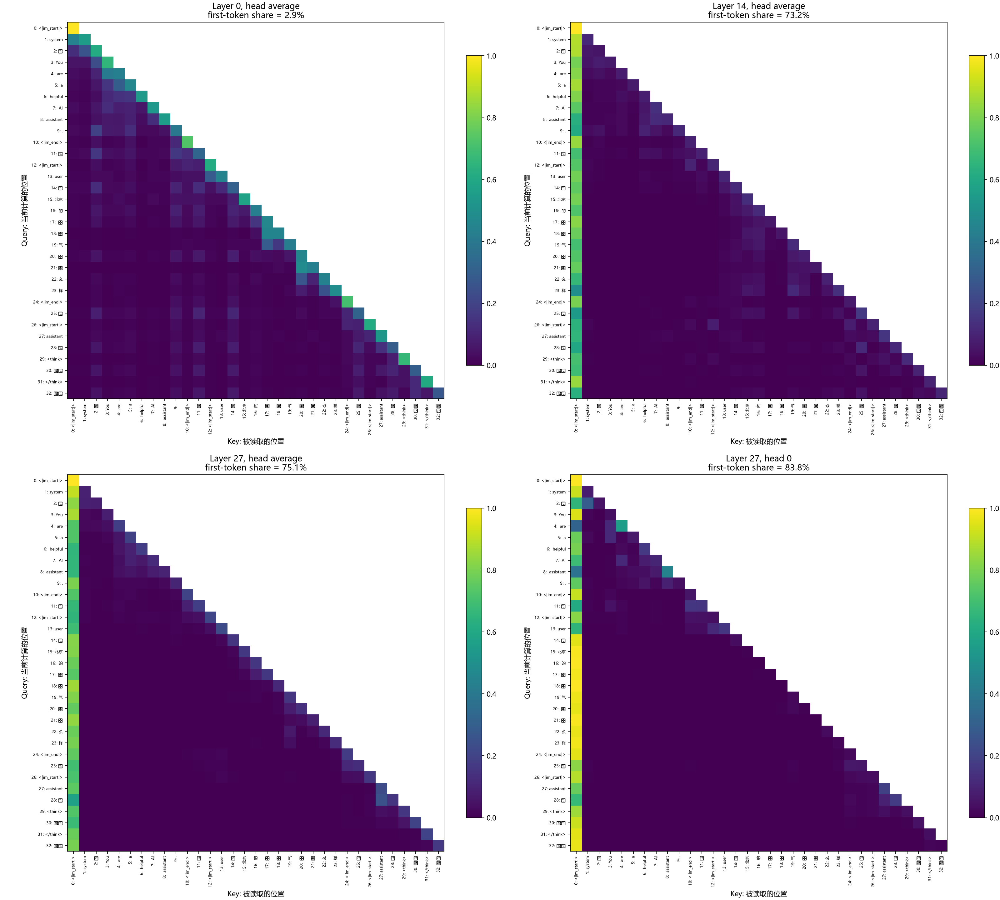

> 记录归属：李卓凡 / `lizhuofan-curry`。原文件：`第二章/2.2注意力机制可视化/实验记录.md`。
> 来源项目提交：`162191203b31ee701f66a1b55b334915f31626e0`；原文SHA-256：`3144a9a51ba4747da21c206fddb9a9c14fb10e3e09d6026ac4f5344efea1d390`。
> 2026-10-28导入已有记录，保留正文、真实运行/离线/参考/计划的原有区分；仅增加归档说明并调整必要相对链接，不代表本次重新运行。附件按本人目录隔离。

# 实验2-2记录

## 2026-10-11：准备代码，待用户运行

已核对官方独立CLI路线，生成独立CPU环境入口和真实Qwen自注意力提取脚本；助手未安装依赖、未下载权重、未执行模型。准备比较同一输入的三个层与一个单独注意力头，保存矩阵、token列表及PNG。模型及环境位于E盘。

当前没有运行结果，不预填attention sink比例，不把书中预期图案作为本次结果。接收用户输出后再补充设备、依赖版本、token数、权重与读图判断。

## 2026-10-11：PyCharm解释器排查与统一环境配置

只读检查确认用户通过最初的独立环境入口已生成20261011_183037_396703/record.json：observation_completed=true，torch=2.14.1+cpu、transformers=4.57.6，28层、单层形状[1,16,33,33]。该记录证明真实注意力已提取，图像分析尚待完成。

随后PyCharm运行仍使用根目录.venv，报No module named torch。检查发现依赖在实验独立.venv中，而根目录环境缺失。用户提出按实验独立配置或补齐共用环境；现生成共用环境安装脚本，将CPU PyTorch和Transformers写入默认chapter2依赖组，run.ps1改用根目录解释器。助手未代执行安装或实验，待用户同步环境。既有HF模型缓存及结果保留，不需要重复下载权重。

用户随后反馈共用环境同步已安装15个包，包括torch=2.14.1+cpu和transformers=4.57.6；最后的Python -c检查因Windows PowerShell传参时字符串引号丢失而出现SyntaxError。此错误发生在检查代码解析阶段，不是依赖安装失败，也不影响此前的注意力结果。已将检查代码移至独立check_shared_environment.py，并修改安装入口调用文件；助手只做语法检查，导入检查仍由用户执行确认。

## 2026-10-11：共用环境验证与清理

用户运行检查成功：Python路径为E:\AI_Agents_Book\.venv\Scripts\python.exe，torch=2.14.1+cpu、transformers=4.57.6，输出SHARED_ENV_READY。用户随后明确要求清理多余环境和文件。

清理范围为本实验旧.venv及临时prepare_shared_environment.ps1、check_shared_environment.py；run.ps1改为直接同步共用环境再运行主代码。保留根目录.venv、HF模型缓存、全部实验运行结果和主代码。删除前核对绝对路径、目录不是重解析链接，并确认共用解释器、依赖目录、模型缓存和结果记录存在；助手未代执行实验。

## 2026-10-11：实际矩阵统计与读图

已只读核对[record.json](运行结果/20261011_183037_396703/record.json)，并查看[四图对照](运行结果/20261011_183037_396703/attention_comparison.png)。输入采用模型聊天模板，33个token；其中包含系统指令、用户短句、角色及特殊标记。所有层结果为[1,16,33,33]，从28层中选择以下四张表：

图1：相同输入下，左上为第0层头平均，右上为第14层头平均，左下为第27层头平均，右下为第27层第0头。纵轴是Query位置，横轴是Key位置；色标统一为0～1，越亮表示权重越大。第一列集中反映本次输入中的attention sink；不等于该token对最终答案具有最大因果贡献。

| 选择 | 首token平均权重（排除第0行） | 最大行和误差 | 未来位置最大权重 |
| --- | --- | --- | --- |
| 第0层，头平均 | 2.86% | 1.19e-7 | 0 |
| 第14层，头平均 | 73.21% | 1.19e-7 | 0 |
| 第27层，头平均 | 75.12% | 2.38e-7 | 0 |
| 第27层，第0头 | 83.81% | 3.58e-7 | 0 |

图中第0层对角线较亮，第14及27层的第一列明显更亮，最后一层第0头的首token集中度高于该层头平均。这支持本次短输入中存在跨层/跨头差异及attention sink现象。第一个token是<|im_start|>；较大权重不等于它在语义上最重要。排除第0行，是因为它只能关注自己。

图的右上三角为绘图时遮挡的空白；原始矩阵统计确认未来位置权重为0。四图使用相同0～1色标；行和误差均在容差内。单token解码出现替换字符是字节片段单独显示的问题，不改变实际模型输入编号。

本地学习范围已完成：真实输入阶段注意力提取、相同输入的跨层及单头/头平均对照、数值检查、热力图与原始数据保存，以及对应代码讲解。未实施生成续写、思考/输出两阶段、工具轨迹或状态栏对照；不以短句图推断长上下文位置偏好或答案的因果贡献。
