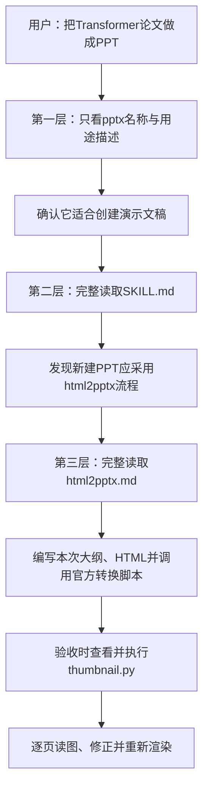

# 实验2-6：Codex从头生成PPT与渐进式披露记录

日期：2026年10月12日，Asia/Shanghai。

用户要求：改由Codex从原始Transformer论文重新生成演示文稿，展示Skill渐进式披露过程，并保存实际记录。昨天Kimi的限流、中间HTML和失败记录继续保留；这次没有读取或复用昨天的大纲、页面稿或裁剪图片。

## 1. 这次到底用了什么

- 执行者：当前Codex对话，由助手编写内容、调用工具并检查产物；没有额外启动Codex CLI，没有再次请求Kimi或Moonshot API。
- 输入：[原始论文](../../材料/attention-is-all-you-need.pdf)，《Attention Is All You Need》，本地15页PDF，arXiv v7。
- 实验Skill：`../../skills/pptx/`，沿用已经准备好的固定版本官方PPTX Skill。
- 生成路线：HTML页面 → 实际调用官方`html2pptx.js` → PPTX → 官方`thumbnail.py` → LibreOffice PDF → Poppler逐页图像。
- 文本和补充表格可编辑。论文原图按任务要求以图片嵌入，保持原文件字节一致。

通用演示文稿技能和PDF技能提供额外的写作、渲染检查要求；此次实验指定的作者流程仍是官方PPTX Skill的HTML转换路线，没有改用通用Artifact Tool或python-pptx生成器。

## 2. 渐进式披露在哪里发生

“披露”在这里表示将某部分内容读入模型的工作上下文，不是把文件公开发布，也不是更新模型参数。

### 第一层：先知道“有什么能力”

本次先读取`SKILL.md`前置元数据6行，内容包括`name`、`description`和许可证声明。名称是`pptx`，用途概括为创建、编辑和分析演示文稿。

当前任务是从论文创建PPT，因此判断它相关。此时在本次新任务的操作顺序中，还没有读取完整主说明或`html2pptx.md`。

记录：[disclosure.jsonl](disclosure.jsonl)中的`01_metadata`，北京时间15:58:48。

### 第二层：选中以后，读取主要流程

接着完整读取`SKILL.md`，发现它包含不同工作路线：读取现有PPT、编辑现有PPT、新建PPT、使用模板等。

本次要从论文新建无模板PPT，所以采用它指定的`html2pptx`路线。主说明进一步要求：每页HTML具有固定尺寸，转换后生成缩略图并检查布局。

这里才获得“接下来该查哪份参考”的信息，没有把全部参考目录批量加载。记录为`02_instructions`，北京时间15:59:22。

### 第三层：选择路线以后，读取详细方法

然后完整读取`html2pptx.md`，获得具体规则：

1. 16:9页面采用720pt × 405pt。
2. 文本需要放进`p`、标题或列表标签。
3. 图像、文本、占位区域怎样交给转换器。
4. 使用`html2pptx()`返回幻灯片和占位区域，再加入原生表格。
5. 通过`writeFile()`导出PPTX。

记录为`03_reference`，北京时间16:00:00。本次没有读取不相关的`ooxml.md`或模板替换参考。

### 执行与排错：程序运行和“读取全文”不同

运行官方`html2pptx.js`不要求先把其全部源码塞入模型上下文。正常情况下只需要接口说明，运行结果由工具返回。

在图片路径出错后，才针对性检索该脚本的图片处理代码，确认它剥离`file://`后留下了`/E:/`和URL编码。这是**遇到具体故障后按需读取实现片段**，并非启动时把整个脚本目录预先加载。

Windows路径适配写在本次[build.cjs](build.cjs)的调用入口，官方文件未修改。适配只调整本机路径，没有提供预制大纲、幻灯片内容或替代转换逻辑。

到了验收阶段，才查看`thumbnail.py`的使用方法及其渲染实现，并真实执行它。这里的脚本包含确定的渲染操作，模型负责决定何时使用并解释结果。

## 3. 必须说明的验证边界

本次证明的是：**当前Codex任务按“元数据 → 主说明 → 所选参考 → 工具执行/排错”的顺序组织操作，并生成了真实产物。**

这不是一个干净上下文中的盲测：当前对话此前已介绍过同一Skill及其部分内容。本次没有把本地`pptx`目录安装为Codex原生启动目录，因此不声称证明了Codex启动时自动扫描、展示并自主发现该Skill的内部机制。

`disclosure.jsonl`是依据实际工具调用整理的操作记录，并结合生成程序自动写入的阶段事件。它不是底层模型完整输入导出，也不是虚构的`Skill(pptx)`工具事件。此前Kimi的原始stream日志属于昨天的运行，没有拼接成本次Codex轨迹。

因此可以在实验记录中写“Codex显式分层读取并使用官方PPTX Skill”，若要验证原生发现机制，应另起独立Codex运行、配置Skill目录并保存真实启动与读取日志。

## 4. 从原始论文重新生成

这次用`pypdf`重新提取15页论文文本，保存为[paper.txt](paper.txt)，重新规划[14页大纲](outline.md)。原始论文重新用Poppler渲染，再用[extract_visuals.py](extract_visuals.py)裁剪五张图表。

来源清单：[manifest.json](source_visuals/manifest.json)，保存PDF页码、像素裁剪坐标、200DPI分辨率、尺寸、对应幻灯片号和SHA256。

| 论文图表 | PDF页码 | 本次幻灯片 |
| --- | ---: | ---: |
| Figure 1，Transformer架构 | 3 | 3 |
| Figure 2，点积与多头注意力 | 4 | 4 |
| Table 1，复杂度及路径长度 | 6 | 8 |
| Table 2，机器翻译结果 | 8 | 10 |
| Figure 3，远距离依赖 | 13 | 12 |

论文表2和摘要给出Big英法BLEU 41.8，但正文6.1写41.0。本次第10页按表2显示41.8，同时保留这处不一致说明。表3是newstest2013开发集结果，表2是newstest2014测试集结果，没有混称。

## 5. 实际遇到的问题与修正

| 阶段 | 问题 | 处理与证据 |
| --- | --- | --- |
| 第一次HTML转换 | 第12页文字过近底边，被官方库拒绝 | 缩短侧栏，把解释移到下方；保留`05_repair`事件 |
| PPTX打包 | Windows中文路径编码导致图片无法读取 | 在调用入口解码并去掉盘符前多余斜杠；保留[错误日志](build_error_windows_media.log) |
| 逐页视觉检查 | 第13页`1024`换行，与下一段重叠 | 改为四个明确定位的文本段，再转换、渲染 |
| 原表裁剪 | 第10页上沿残留少量标题笔画 | 调整原始页裁剪上边缘，重新提取和核对哈希 |
| 页脚 | 图表编号接在“第…页”内部不自然 | 统一为“PDF第X页，图表或节号” |

代码退出成功和包检查通过后仍发现视觉问题，说明两种检查各有作用。最终状态见[验收记录](review.md)，自动证据见[validation.json](validation.json)与[实际命令记录](execution_receipts.json)。

## 6. 查看产物与复核

- [PowerPoint文件](presentation.pptx)
- [PDF预览](preview/presentation.pdf)
- [官方脚本生成的缩略图网格](preview/thumbnails.jpg)，图上索引从0开始，对应幻灯片1～14。
- [逐页预览](preview.html)
- [渐进式操作事件](disclosure.jsonl)

最终视觉检查、软件兼容验证和原图字节核对分开记录。未执行Transformer训练，也不把本次产物完成解释为不同模型能力的对照成绩。
