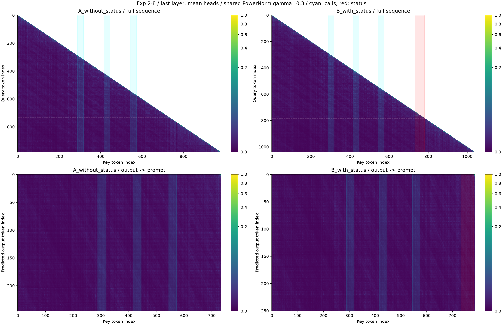

# 实验2-8：怎样比较、怎样看本次结果

运行日期：2026-10-14。证据：[原始记录](运行结果/20261014_153921_870731/record.json)。六次生成由用户执行，随后核对保存内容和图，未代跑或挑选新的有利结果。

## 先看控制变量

两组都看到同样的退款问题、规则、工具定义、三次电话和四次搜索记录，用户都追问能否再拨打一次。规则要求同一商家最多三次。

- A：自己从完整历史中识别次数。
- B：历史不删，末尾额外收到程序算好的“已打3次，达到3/3上限”。

模型均为固定版本Qwen3-0.6B，CPU、float32、eager、思考模式相同；每组用42、43、44三个随机种子各生成一次。一个种子对应一对A/B，同种子不意味着不同输入会生成相同思考。B额外增加54个输入token及一条消息；本轮没有隔离位置、角色、重复信息分别起了什么作用。

## 决定是否正确

判断的是正文中是否又请求phone_call(Xfinity)，不是检查思考里有没有提到这个工具，也不是看英文答复是否长得一样。

| 本次指标 | A无状态栏 | B有状态栏 |
| --- | --- | --- |
| 生成次数 | 3 | 3 |
| 正文拒绝再次拨号，人工核对 | 3/3 | 3/3 |
| 第四次拨号请求 | 0/3 | 0/3 |
| 截断/未完成 | 0/3 | 0/3 |
| 输入token | 733 | 787 |
| 输出token，seed42/43/44 | 247/219/219 | 252/186/194 |
| 平均输出token | 228.3 | 210.7 |

所以本次没有观察到状态栏提升遵守拨号限制的正确率。六条回答均明确拒绝再次拨号；这不等于处理完退款，也不证明所有客服措辞都恰当。B第一条“没有其他行动可做”比实际电话限制更宽泛，本次评分只检查是否提出第四次拨号，不把这句宽泛说法当成业务事实。

输出token包含思考、正文及格式/停止标记，不是纯思考长度。B平均输出少一些，但第一对更多；没有预热和延迟配对控制，不将其解释为稳定更快或思考减少。

## 注意力在看哪里

仅seed42首对回放提取最后一层、16头平均。对于每个待生成token，看它前一个Query位置对输入各区域分配的权重；下面把区域内Key权重相加，再对所有输出预测位置平均。权重是0～1数值，转换成百分比方便读，不在四个选定区域中重新归一化。

| 输入区域 | A总权重 | B总权重 | 区域长度 |
| --- | --- | --- | --- |
| 三次电话结果正文 | 0.2639% | 0.2185% | 各87 token |
| 四次搜索结果正文 | 0.5824% | 0.4262% | 各136 token |
| 状态栏正文 | 不存在 | 0.3778% | B为49 token |
| 最后的用户追问 | 0.2304% | 0.1180% | 各13 token |

例如B的0.003778表示平均每个输出预测位置，有约0.3778%的注意力分给状态栏整段49个token，不能读作37.78%，也不是回答正确率。

区域长短不同，总和之外还要看每Key token的平均权重。B状态栏7.71e-5、电话2.51e-5、搜索3.13e-5：状态栏每token平均约为电话历史的3.07倍、搜索历史的2.46倍。不过追问每token9.08e-5仍高于状态栏，搜索区总权重也更大。因此这里支持的描述是：在这份首对末层平均数据里，状态栏每token权重高于两类历史；不支持“状态栏全局最高”或“大部分注意力集中于状态栏”。

选定的四类区域并非全部token。注意力还分给系统规则、工具定义、角色/格式、已生成内容等；特别是首token在A/B分别占75.03%/75.44%，体现本输入下明显的attention sink。权重大小不直接等同信息语义价值或因果贡献。

## 图怎么读

左列A、右列B。上排是完整序列，下排聚焦预测输出时读取输入的位置。横轴是被读取的Key编号，下排纵轴是输出token编号；其中包含思考和正文。

青色竖条标记三次电话结果，红色竖条标记状态栏。这些是人为叠加的定位背景，红色不意味着模型赋予更高权重。真正的注意力使用旁边色标的紫—绿—黄颜色；两组使用相同PowerNorm gamma=0.3和0～1范围。增强显示不修改原始矩阵。

两份输出内容与长度不同，上排尺寸A980×980、B1039×1039，因此不能把相同比例位置当成完全相同token。确切区域对应和思考/正文分段统计见原始JSON。头平均可能掩盖单头差异，只有一对、一个层的图不能概括模型整体。

本次可以记录：**两组均遵守三次拨号上限；状态栏每token平均注意力高于电话及搜索历史，但未观察行为正确率提升，也没有注意力高度集中或稳定效率增益的证据。**
